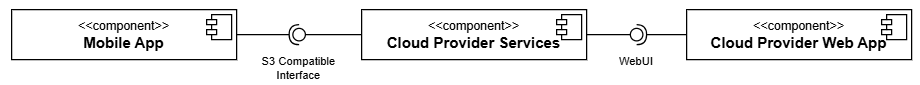

# S3 Client App — Cross-Platform Object Storage Manager

> A cross-platform Flutter application for managing files and buckets on **S3-compatible storage systems**, developed as part of my diploma thesis.  

## Overview

This project demonstrates a **complete S3-compatible client application**, enabling users to manage cloud object storage services directly from a Flutter app.  

The app interacts directly with the chosen cloud storage provider (such as MinIO, Amazon S3, Wasabi, Backblaze B2, or any other service that supports the **S3 API Standard**)

<p style="align-items:center">
  
</p>

_System components_

A practical part of the work includes developing a Flutter application for managing objects stored in Amazon S3-compatible services.”

#### Features:

✅ Connect to any **S3-compatible** service (MinIO, Wasabi, Backblaze B2, AWS S3, etc.)  
✅ View, create, and delete **buckets**  
✅ Upload, download, and delete **objects**  
✅ Generate and view **object metadata**  
✅ Works on **Android**, **iOS**, **Web** and **Desktop** (thanks to Flutter)  
✅ Switch between **different providers** through the app’s settings.

---

## ⚙️ How to Run It Yourself

You can run the entire system locally in just a few steps.  

###  Prerequisites

Before starting, make sure you have:

- [Flutter SDK](https://flutter.dev/docs/get-started/install)
- Either:
  - 🐳 [Docker](https://www.docker.com/) — easiest setup, or  
  - 💻 [MinIO executable](https://min.io/download) — manual setup without Docker
  - 🌐 (Or any other S3-compatible provider that you can host yourself)

---

### Step 1: Run the MinIO Server

MinIO is an **S3-compatible object storage service**, which will act as your local “cloud.”

You can start it **either using Docker** or **by running the executable directly**.

#### Option 1 — Run via Docker (recommended)

```bash
docker run -p 9000:9000 -p 9001:9001 \
  --name minio \
  -e "MINIO_ROOT_USER=admin" \
  -e "MINIO_ROOT_PASSWORD=password123" \
  -v ~/minio/data:/data \
  quay.io/minio/minio server /data --console-address ":9001"
```
Once started, open the MinIO Console in your browser: http://localhost:9001

Login using:
```makefile
    Username: admin
    Password: password123
```

You can now create buckets, upload test files, or just explore the interface in the MinIO client.

---

#### Option 2 — Run via minio.exe (no Docker needed)

If you don’t want to use Docker:

Download the executable for your platform from [MinIO Downloads](https://www.min.io/download?platform=windows)
.

Extract it somewhere convenient, open a terminal in that directory and run:

```bash
minio.exe server <path_to_minio_executable> --console-address ":9001"
```


You’ll see logs indicating that the server has started.
Visit http://localhost:9001
 — same login (admin / password123).

That’s it — your local object storage service is now live.

---

### Step 2: Run the Flutter App

#### 1. Clone this repository:

```bash
git clone https://github.com/DaniloVrancic/s3-client-app.git
cd s3-client-app
```

#### 2. Install dependencies:

```bash
flutter pub get
```

#### (Optionally)

You can change the default IP address that will be targeted by the app at start, by changing the `DEFAULT_ADDRESS` value to your desired string.
Same applies for the port value.

#### 3. Run the app:
```bash
flutter run
```

You can run it on:
- Android Emulator
- iOS Emulator
- Web Browser (`flutter run -d chrome`)
- Desktop (`flutter run -d` `windows` / `macos` / `linux`)

